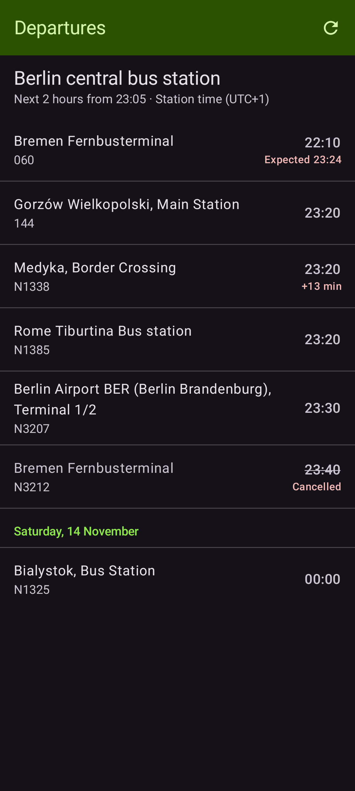

# Departure board

A one-screen Android app. It shows bus departures from one station (Berlin ZOB) for the next two hours.
Times are shown in the station's time zone, whatever zone the phone is in.

  

## Run

1. Add the API key. It is not in git. Put this line into `~/.gradle/gradle.properties`
   (or pass `-PtimetableApiKey=<key>`, or set `TIMETABLE_API_KEY`):
   ```
   timetableApiKey=<the key from the task>
   ```
   Without it the build prints a warning, and a debug build says so on the error screen. Tests do not need it.
2. Build and run. Android Studio 2025.3 or newer, JDK 21, a device or emulator with Android 8.0 (API 26) or newer.
   ```
   ./gradlew installDebug          # build and install on a device or emulator
   ./gradlew testDebugUnitTest     # all tests, on the JVM, no emulator, no network
   ./gradlew recordRoborazziDebug  # re-record the screenshot goldens after a UI change
   ./gradlew connectedDebugAndroidTest  # end-to-end tests, needs a running emulator or device
   ```

## What it does

- Loads departures for `now` to `now + 2h` on start. Each row: direction, line code, scheduled time.
- Shows the station name and `Next 2 hours from 23:05 · Station time (UTC+1)` above the list. The start time is also the data time.
- Marks delays (`+13 min`, or `Expected 23:24` above 30 minutes) and cancelled rides.
- Loading, empty and error states. Pull to refresh and a Refresh button. A failed refresh keeps the list and shows a banner.
- On return to the app: reloads when the data is older than one minute, retries after an error.

## Assumptions

- The scheduled time is the departure time. A delay is shown next to it, the list is not re-sorted by it.
- Cancelled rides stay in the list and are marked with the word "Cancelled".
- Late rides scheduled before `now` are kept. The API returns them on purpose: they have not left yet.

## Architecture

One module, three packages. `domain` is plain Kotlin, no Android, no network. Hilt wires it in `di/`.

```
ui/timetable                      domain                      data
TimetableScreen (Compose)         Timetable, Departure        DefaultTimetableRepository
   ^ TimetableUiState             LoadResult                     -> TimetableApi (Retrofit, OkHttp)
TimetableViewModel  -- calls -->  TimetableRepository  <------   -> TimetableMapper (DTO to domain)
   (Clock, 2 hour window)                              implements
```

The ViewModel asks for one window, the repository returns `LoadResult<Timetable>`, the screen renders one state.

## Decisions

| Decision | Why | Not taken |
|---|---|---|
| One module, `ui -> domain <- data`, no use cases | One screen. A use case would only forward the call | Multi-module, clean architecture layers |
| Own `LoadResult` with two errors: `NoConnection` (any `IOException`, also timeouts and TLS errors), `Unexpected` (everything else) | The user has two actions: check the connection or retry. `kotlin.Result` loses the error type | One error per HTTP code |
| Error bodies are never read | The API sends plain text, JSON or an empty body | Parsing error JSON |
| Lenient parsing: a broken ride is dropped, the rest is shown | Only four fields are needed. One bad ride must not empty the screen | Failing the whole response |
| Delay follows `deviation_class`: `LATE` is delayed (expected time from `deviation_timestamp`), `CANCELLED` is cancelled, `ON_TIME` and unknown classes are scheduled | The backend owns the delay rules, so Android shows the same as web and iOS. A new class shows the plain time, never a wrong delay | Own threshold on the timestamp |
| Caption `UTC+1`, computed from the offset | `CET`, `MEZ` and `GMT+1` differ between JVM, locale and Android | Zone abbreviations |
| Explicit `HH:mm` / `h:mm a` patterns, 12/24h from the device | Localized styles ignore the 12/24h switch and differ between JDKs | `ofLocalizedTime` |
| Date header pattern from the locale (`getBestDateTimePattern`) | `Saturday, November 14` in the US, `Samstag, 14. November` in Germany | One fixed pattern for all locales |
| `Clock` injected, read only in the ViewModel | Windows, the stale check and dates are testable | `Instant.now()` |
| Failed refresh is state (`refreshError`), not a one-off event | Survives rotation, no `Channel` needed | Snackbar |
| A refresh while a request runs is skipped | Same request, no duplicates | Cancelling the running request |

## Edge cases

| Case | Behavior | Test |
|---|---|---|
| Phone in another zone than the station | Station time is shown | `TimeFormatterTest.formats in station zone not device zone` (the test JVM runs in Asia/Kolkata) |
| Missing or invalid station zone | UTC with a caption saying so | `TimetableMapperTest.falls back to UTC when station time zone is missing or invalid`, `TimetableScreenTest.unknown station zone shows the UTC caption` |
| Spring DST night | 01:20 then 03:20, no gap handling needed | `TimeFormatterTest.formats across spring DST jump` |
| Autumn DST night | Two rides can show the same `02:30`, the order is still real | `TimeFormatterTest.repeats the hour on autumn DST night`, `TimetableTest.orders by scheduled time then line code then id` |
| Window crosses midnight | Date header `Saturday, November 14` (en-US) | `TimetableItemsTest.adds header before first ride of next day` |
| Late ride from yesterday | Header for yesterday, then for today | `TimetableItemsTest.adds headers for a late ride from yesterday and for today after it` |
| Ride without id, code, direction or a valid time, or with a wrong type | Dropped, other rides stay | `TimetableMapperTest.drops ride with unparseable scheduled time` and the other `drops ...` tests, `TimetableJsonTest.ride with a wrong type becomes an empty ride and the others stay` |
| Duplicate ride ids | First one kept | `TimetableMapperTest.removes duplicate ride ids` |
| Delay under one minute or early departure | Shown as scheduled | `TimetableMapperTest.ignores delay under one minute and early departure` |
| `ON_TIME` with a later timestamp, unknown class | Shown as scheduled | `TimetableMapperTest.on time class with a later timestamp shows no delay`, `TimetableMapperTest.unknown or missing class is scheduled whatever the timestamp` |
| Delay above 30 minutes | `Expected HH:mm` instead of minutes | `DepartureRowTest.delay above 30 minutes shows expected time` |
| Cancelled ride | Struck time and "Cancelled" | `DepartureRowTest.cancelled ride shows the word`, screenshot `content` |
| 401, 400, 404 with empty body, 503, broken JSON, 204 without body | "Something went wrong" with Retry | `TimetableRepositoryTest.maps ...` tests |
| No network, or no full answer in 15 s | "No connection" with Retry | `TimetableRepositoryTest.maps connection failure to no connection`, `TimetableRepositoryTest.maps call timeout on a slow body to no connection` |
| Refresh fails with a list on screen | List stays, banner with the data time | `TimetableViewModelTest.failed refresh keeps content and sets refresh error`, `TimetableScreenTest.failed refresh shows banner above the list` |
| Empty response | "No departures", pull to refresh still works | `TimetableScreenTest.empty shows message` |
| 200% font size | Nothing is cut, the status wraps | screenshot `content_font_2x` |

`DefaultTimetableRepository` reports unexpected failures and the number of dropped rides to `ErrorReporter` (no-op now, never given a URL because it has the key); Crashlytics would plug in by binding its own implementation in `ReportingModule`.

## Tests

101 tests on the JVM (Robolectric for Android parts), no emulator, no network, and 8 instrumented tests on an emulator:

| Type | Count | What |
|---|---|---|
| Unit | 34 | Domain, JSON models, mapper, time formatting, date headers |
| Data | 18 | Repository on real OkHttp, Retrofit and MockWebServer with saved real API responses (`app/src/test/resources/fixtures`), what goes to `ErrorReporter`; the production `NetworkModule` with a fake transport (URL, path, API key) |
| ViewModel | 15 | Fake repository, mutable clock, Turbine |
| Compose UI | 29 | Row and screen on Robolectric, TalkBack descriptions, the formatter built from device locale and 12/24h setting |
| Screenshot | 5 | Roborazzi goldens in `app/src/test/screenshots`: content, dark, 200% font, empty, no connection |
| Instrumented | 8 | Real Activity, ViewModel, OkHttp and Retrofit on an emulator, against MockWebServer (`app/src/androidTest`) |

```
./gradlew testDebugUnitTest      # all 101
./gradlew verifyRoborazziDebug   # all 101, and screenshots compared with the goldens
```

CI runs `ktlintCheck lintDebug verifyRoborazziDebug assembleRelease` on every push.

The 101 above do not include the instrumented ones. They run the real `MainActivity` and ViewModel with Hilt.
`TestAppModule` replaces the network and data modules: the same OkHttp setup is built again against MockWebServer,
and the `Clock` is a test clock. They cover cold start, error then Retry,
pull to refresh, rotation without a new request, return after the stale time, relaunch, delayed and cancelled rows.
Debug builds allow cleartext to `localhost` for the mock server. Run them with `./gradlew connectedDebugAndroidTest`
on an emulator with Android 8.0 or newer, or start the manual `E2E` workflow on GitHub. They are not part of CI.

## Not done on purpose

- Auto-refresh on a timer: left out to keep to the task scope, see Next steps. The data time in the header
  and the reload on return to the app cover the common case.
- Offline cache: an old timetable misleads. The HTTP cache does not help because `from` changes every time.
- Station picker, arrivals, ride details: the screen asks for one list.
- Modules and KMP: one screen. A split would be `:core:domain`, `:data:timetable`, `:feature:timetable`.
  For KMP, Retrofit would move to Ktor and `java.time` to `kotlinx-datetime`.
- Translations: all text is in `strings.xml`, minutes and hours use plurals.
- compileSdk 37: it needs a newer AGP. OkHttp stays on 5.4 until then, 5.5 needs compileSdk 37.

## Next steps

- Auto-refresh while the screen is visible: `repeatOnLifecycle` in `MainActivity` calling `TimetableViewModel.refresh()`.
- Search by direction or line code: a query in `TimetableUiState.Loaded`, the visible list filtered from it.
- Station picker: `TimetableViewModel.STATION_ID` becomes state. The header and the zone already come from the response.
- Longer window: `TimetableViewModel.WINDOW` becomes state. The API allows up to 36 hours.
- Offline: a cache behind `TimetableRepository`, with the data time already shown by the banner.

## AI use

I used AI as a tool, under my supervision at both the high level and the low level.

The design and a commit-by-commit plan came first: the API research, the edge cases, and for each commit
its rules and the tests that prove them. Then the code was generated with AI tooling, commit by commit from
that plan, and I reviewed each one. That is why the first commit times are seconds to minutes apart.
The later commits are fixes after review rounds.
