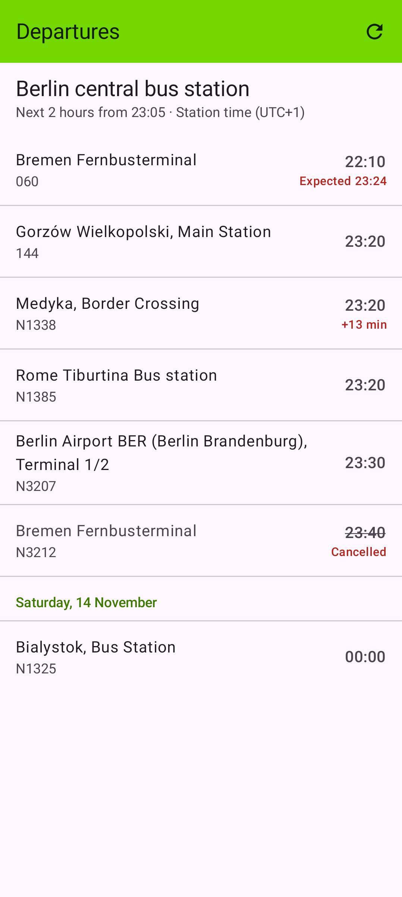

# Departure board

A one-screen Android app. It shows bus departures from one station (Berlin ZOB) for the next two hours.
Times are shown in the station's time zone, whatever zone the phone is in.

  

## Run

Android Studio 2025.3 or newer, JDK 21.

```
./gradlew installDebug          # build and install on a device or emulator
./gradlew testDebugUnitTest     # all tests, on the JVM, no emulator, no network
./gradlew recordRoborazziDebug  # re-record the screenshot goldens after a UI change
```

The API key is not in git. Add `timetableApiKey=<key>` to `~/.gradle/gradle.properties`,
or pass `-PtimetableApiKey=<key>`, or set `TIMETABLE_API_KEY`. Tests do not need it.

## What it does

- Loads departures for `now` to `now + 2h` on start. Each row: direction, line code, scheduled time.
- Shows the station name and `Next 2 hours · Station time (UTC+1)` above the list.
- Marks delays (`+13 min`, or `Expected 23:24` above 30 minutes) and cancelled rides.
- Loading, empty and error states. Pull to refresh and a Refresh button. A failed refresh keeps the list and shows a banner.
- Refreshes on return to the app when the data is older than one minute.

## Assumptions

- The scheduled time is the departure time. A delay is shown next to it, the list is not re-sorted by it.
- Cancelled rides stay in the list and are marked with the word "Cancelled".
- Late rides scheduled before `now` are kept. The API returns them on purpose: they have not left yet.

## Decisions

| Decision | Why | Not taken |
|---|---|---|
| One module, `ui -> domain <- data`, no use cases | One screen. A use case would only forward the call | Multi-module, clean architecture layers |
| Own `LoadResult` with two errors: `NoConnection`, `Unexpected` | The user has two actions: check the connection or retry. `kotlin.Result` loses the error type | One error per HTTP code |
| Error bodies are never read | The API sends plain text, JSON or an empty body | Parsing error JSON |
| Lenient parsing: a broken ride is dropped, the rest is shown | Only four fields are needed. One bad ride must not empty the screen | Failing the whole response |
| Delay is decided by the timestamp, not `deviation_class` | The timestamp is a fact, an unknown class cannot break it | Trusting the class |
| Caption `UTC+1`, computed from the offset | `CET`, `MEZ` and `GMT+1` differ between JVM, locale and Android | Zone abbreviations |
| Explicit `HH:mm` / `h:mm a` patterns, 12/24h from the device | Localized styles ignore the 12/24h switch and differ between JDKs | `ofLocalizedTime` |
| `Clock` injected, read only in the ViewModel | Windows, the stale check and dates are testable | `Instant.now()` |
| Failed refresh is state (`refreshError`), not a one-off event | Survives rotation, no `Channel` needed | Snackbar |
| A refresh while a request runs is skipped | Same request, no duplicates | Cancelling the running request |

## Edge cases

| Case | Behavior | Test |
|---|---|---|
| Phone in another zone than the station | Station time is shown | `TimeFormatterTest.formats in station zone not device zone` (the test JVM runs in Asia/Kolkata) |
| Missing or invalid station zone | UTC with a caption saying so | `TimetableMapperTest.falls back to UTC when station time zone is missing or invalid`, `TimetableScreenTest.unknown station zone shows the UTC caption` |
| Spring DST night | 01:20 then 03:20, no gap handling needed | `TimeFormatterTest.formats across spring DST jump` |
| Autumn DST night | Two rides can show the same `02:30`, the order is still real | `TimeFormatterTest.repeats the hour on autumn DST night`, `TimetableTest.orders by scheduled time then line code then id` |
| Window crosses midnight | Date header `Saturday, 14 November` | `TimetableItemsTest.adds header before first ride of next day` |
| Late ride from yesterday | Header for yesterday, then for today | `TimetableItemsTest.adds headers for a late ride from yesterday and for today after it` |
| Ride without id, code, direction or a valid time | Dropped, other rides stay | `TimetableMapperTest.drops ride with unparseable scheduled time` and the other `drops ...` tests |
| Duplicate ride ids | First one kept | `TimetableMapperTest.removes duplicate ride ids` |
| Delay under one minute or early departure | Shown as scheduled | `TimetableMapperTest.ignores delay under one minute and early departure` |
| Delay above 30 minutes | `Expected HH:mm` instead of minutes | `DepartureRowTest.delay above 30 minutes shows expected time` |
| Cancelled ride | Struck time and "Cancelled" | `DepartureRowTest.cancelled ride shows the word and a struck time` |
| 401, 400, 404 with empty body, 503, broken JSON, 204 without body | "Something went wrong" with Retry | `TimetableRepositoryTest.maps ...` tests |
| No network | "No connection" with Retry | `TimetableRepositoryTest.maps connection failure to no connection` |
| Refresh fails with a list on screen | List stays, banner with the data time | `TimetableViewModelTest.failed refresh keeps content and sets refresh error`, `TimetableScreenTest.failed refresh shows banner above the list` |
| Empty response | "No departures", pull to refresh still works | `TimetableScreenTest.empty shows message` |
| 200% font size | Nothing is cut, the status wraps | screenshot `content_font_2x` |

Dropped rides are silent now. In production they would be reported to crash reporting as non-fatals.

## Tests

80 JVM tests and 5 screenshot goldens, no emulator needed:

- Pure unit tests: domain, JSON models, mapper, time formatting, date headers.
- Repository on real OkHttp, Retrofit and MockWebServer, with saved real API responses in `app/src/test/resources/fixtures`.
- ViewModel with a fake repository, a mutable clock and Turbine.
- Compose UI tests on Robolectric for the row and the screen, including TalkBack descriptions.
- Roborazzi screenshots in `app/src/test/screenshots`: content, dark, 200% font, empty, no connection.
  `./gradlew verifyRoborazziDebug` compares them and also runs all unit tests.

Not covered by automated tests: the real API, the pull gesture, `onStart` calling the stale check, rotation and process death.
These were checked by hand on an emulator. Instrumented tests are the next step; the API factory, the Hilt modules and the clock are the seams.

## Not done on purpose

- Auto-refresh on a timer: easy to get wrong with the lifecycle. `refresh()` is ready for it.
- Offline cache: an old timetable misleads. The HTTP cache does not help because `from` changes every time.
- Station picker, arrivals, ride details: the screen asks for one list.
- Modules and KMP: one screen. A split would be `:core:domain`, `:data:timetable`, `:feature:timetable`.
  For KMP, Retrofit would move to Ktor and `java.time` to `kotlinx-datetime`.
- Translations: all text is in `strings.xml`, minutes and hours use plurals.

compileSdk is 36. Moving to 37 also needs a newer AGP and lets OkHttp go past 5.4.

## Next steps

- Auto-refresh while the screen is visible: `repeatOnLifecycle` in `MainActivity` calling `TimetableViewModel.refresh()`.
- Search by direction or line code: a query in `TimetableUiState.Loaded`, the visible list filtered from it.
- Station picker: `TimetableViewModel.STATION_ID` becomes state. The header and the zone already come from the response.
- Longer window: `TimetableViewModel.WINDOW` becomes state. The API allows up to 36 hours.
- Offline: a cache behind `TimetableRepository`, with the data time already shown by the banner.

## AI use

I used AI while building this, under my supervision at both the high level and the low level.
