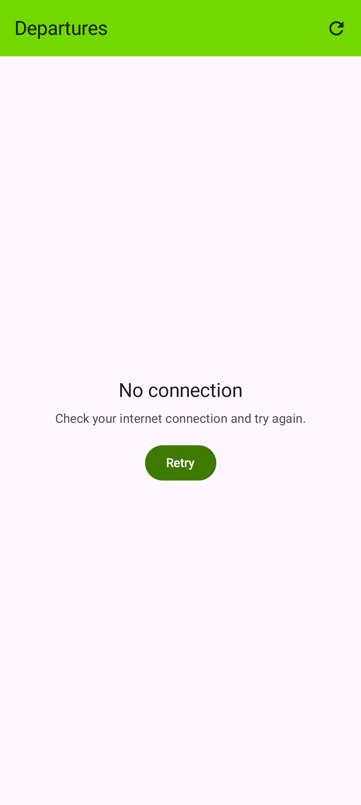
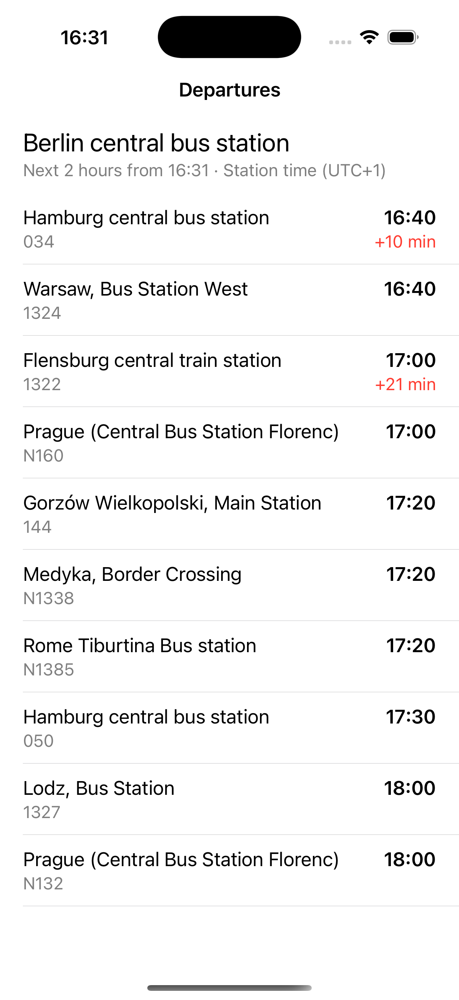

# Departure board

An Android app and a small iOS app on one shared Kotlin module. They show bus departures from one station
(Berlin ZOB) for the next two hours. Times are shown in the station's time zone, whatever zone the phone is in.

   

## Run

1. Add the API key. It is not in git. Put this line into `~/.gradle/gradle.properties`
   (or pass `-PtimetableApiKey=<key>`, or set `TIMETABLE_API_KEY`):
   ```
   timetableApiKey=<the key from the task>
   ```
   Without it the build prints a warning, and a debug build says so on the error screen. Tests do not need it.
2. Build and run. Android Studio 2025.3 or newer, JDK 21, a device or emulator with Android 8.0 (API 26) or newer.
   ```
   ./gradlew installDebug          # build and install on a device or emulator
   ./gradlew testDebugUnitTest     # all tests, on the JVM, no emulator, no network
   ./gradlew recordRoborazziDebug  # re-record the screenshot goldens after a UI change
   ./gradlew connectedDebugAndroidTest  # end-to-end tests, needs a running emulator or device
   ./gradlew :shared:testAndroidHostTest      # shared tests on the JVM
   ./gradlew :shared:iosSimulatorArm64Test    # the same shared tests on the iOS simulator
   ```
3. iOS. Xcode 16 or newer and JDK 21. Create `iosApp/Local.xcconfig` (it is not in git) with one line:
   ```
   TIMETABLE_API_KEY = <the key from the task>
   ```
   Open `iosApp/iosApp.xcodeproj` and press Run on an iPhone simulator. The first build is slow:
   a build phase runs Gradle and builds the shared framework. Without the key the app shows the error screen.

## What it does

- Loads departures for `now` to `now + 2h` on start. Each row: direction, line code, scheduled time.
- Shows the station name and `Next 2 hours from 23:05 · Station time (UTC+1)` above the list. The start time is also the data time.
- Marks delays (`+13 min`, or `Expected 23:24` above 30 minutes) and cancelled rides.
- Loading, empty and error states. Pull to refresh and a Refresh button. A failed refresh keeps the list and shows a banner.
- On return to the app: reloads when the data is older than one minute, retries after an error.

## Assumptions

- The scheduled time is the departure time. A delay is shown next to it, the list is not re-sorted by it.
- Cancelled rides stay in the list and are marked with the word "Cancelled".
- Late rides scheduled before `now` are kept. The API returns them on purpose: they have not left yet.

## Architecture

Two apps on one `shared` module. `domain` is plain Kotlin, no Android, no network. Hilt wires it in `app/di/`.

```
app (Compose, Hilt, ViewModel)        iosApp (SwiftUI, TimetableModel)
        \                                  /
         v                                v
shared  (Kotlin Multiplatform: android, iosArm64, iosSimulatorArm64)
  domain   Timetable, Departure, LoadResult, TimetableRepository, TimetableDefaults
  data     DefaultTimetableRepository -> TimetableApi (Ktor) ; TimetableMapper (DTO to domain)
  display  formatUtcOffset, delayLabel
```

The ViewModel asks for one window, the repository returns `LoadResult<Timetable>`, the screen renders one state.
The Ktor engine is a parameter: OkHttp on Android, Darwin on iOS, MockEngine in tests.

## Decisions

| Decision | Why | Not taken |
|---|---|---|
| One module, `ui -> domain <- data`, no use cases | One screen. A use case would only forward the call | Multi-module, clean architecture layers |
| Ktor instead of Retrofit, engine passed as a parameter | Retrofit is JVM only. The body is read as text and decoded with the same `Json`, no ContentNegotiation | expect/actual engines, Ktor ContentNegotiation |
| `kotlinx-datetime` instead of `java.time` in shared code | `java.time` does not exist on iOS. `java.time` stays only in `TimeFormatter`, where text is built | Own time types |
| Hilt only in `:app`, no SKIE | Shared code has no `javax.inject`, classes are built in `@Provides`. Plain Kotlin/Native interop is enough for one entry point | Koin, SKIE |
| Own `LoadResult` with two errors: `NoConnection` (any `IOException`, also timeouts and TLS errors), `Unexpected` (everything else) | The user has two actions: check the connection or retry. `kotlin.Result` loses the error type | One error per HTTP code |
| Error bodies are never read | The API sends plain text, JSON or an empty body | Parsing error JSON |
| Lenient parsing: a broken ride is dropped, the rest is shown | Only four fields are needed. One bad ride must not empty the screen | Failing the whole response |
| Delay follows `deviation_class`: `LATE` is delayed (expected time from `deviation_timestamp`), `CANCELLED` is cancelled, `ON_TIME` and unknown classes are scheduled | The backend owns the delay rules, so Android shows the same as web and iOS. A new class shows the plain time, never a wrong delay | Own threshold on the timestamp |
| Caption `UTC+1`, computed from the offset | `CET`, `MEZ` and `GMT+1` differ between JVM, locale and Android | Zone abbreviations |
| Explicit `HH:mm` / `h:mm a` patterns, 12/24h from the device | Localized styles ignore the 12/24h switch and differ between JDKs | `ofLocalizedTime` |
| Date header pattern from the locale (`getBestDateTimePattern`) | `Saturday, November 14` in the US, `Samstag, 14. November` in Germany | One fixed pattern for all locales |
| `Clock` injected, read only in the ViewModel | Windows, the stale check and dates are testable | `Clock.System.now()` in the screen |
| Failed refresh is state (`refreshError`), not a one-off event | Survives rotation, no `Channel` needed | Snackbar |
| A refresh while a request runs is skipped | Same request, no duplicates | Cancelling the running request |

## Edge cases

| Case | Behavior | Test |
|---|---|---|
| Phone in another zone than the station | Station time is shown | `TimeFormatterTest.formats in station zone not device zone` (the test JVM runs in Asia/Kolkata) |
| Missing or invalid station zone | UTC with a caption saying so | `TimetableMapperTest.falls back to UTC when station time zone is missing or invalid`, `TimetableScreenTest.unknown station zone shows the UTC caption` |
| Spring DST night | 01:20 then 03:20, no gap handling needed | `TimeFormatterTest.formats across spring DST jump` |
| Autumn DST night | Two rides can show the same `02:30`, the order is still real | `TimeFormatterTest.repeats the hour on autumn DST night`, `TimetableTest.orders by scheduled time then line code then id` |
| Window crosses midnight | Date header `Saturday, November 14` (en-US) | `TimetableItemsTest.adds header before first ride of next day` |
| Late ride from yesterday | Header for yesterday, then for today | `TimetableItemsTest.adds headers for a late ride from yesterday and for today after it` |
| Ride without id, code, direction or a valid time, or with a wrong type | Dropped, other rides stay | `TimetableMapperTest.drops ride with unparseable scheduled time` and the other `drops ...` tests, `TimetableJsonTest.ride with a wrong type becomes an empty ride and the others stay` |
| Duplicate ride ids | First one kept | `TimetableMapperTest.removes duplicate ride ids` |
| Delay under one minute or early departure | Shown as scheduled | `TimetableMapperTest.ignores delay under one minute and early departure` |
| `ON_TIME` with a later timestamp, unknown class | Shown as scheduled | `TimetableMapperTest.on time class with a later timestamp shows no delay`, `TimetableMapperTest.unknown or missing class is scheduled whatever the timestamp` |
| Delay above 30 minutes | `Expected HH:mm` instead of minutes | `DepartureRowTest.delay above 30 minutes shows expected time` |
| Cancelled ride | Struck time and "Cancelled" | `DepartureRowTest.cancelled ride shows the word`, screenshot `content` |
| 401, 400, 404 with empty body, 503, broken JSON, 204 without body | "Something went wrong" with Retry | `TimetableRepositoryTest.maps ...` tests |
| No network, or no full answer in 15 s | "No connection" with Retry | `TimetableRepositoryTest.maps connection failure to no connection`, `TimetableRepositoryTest.maps request timeout to no connection`, `OkHttpEngineTest.maps timeout on a slow body to no connection` |
| Refresh fails with a list on screen | List stays, banner with the data time | `TimetableViewModelTest.failed refresh keeps content and sets refresh error`, `TimetableScreenTest.failed refresh shows banner above the list` |
| Empty response | "No departures", pull to refresh still works | `TimetableScreenTest.empty shows message` |
| 200% font size | Nothing is cut, the status wraps | screenshot `content_font_2x` |

`DefaultTimetableRepository` reports unexpected failures and the number of dropped rides to `ErrorReporter` (no-op now, never given a URL because it has the key); Crashlytics would plug in by binding its own implementation in `ReportingModule`.

## Tests

107 tests run for Android on the JVM (64 in `app`, 43 in `shared`), no emulator, no network. The 43 shared tests also run on the iOS simulator. 8 instrumented tests run on an emulator.

| Where | Count | What |
|---|---|---|
| `shared` commonTest | 43 | Domain, JSON models, mapper, display rules (delay label, UTC offset). The repository on a Ktor `MockEngine` with saved real API responses (`shared/src/commonTest/resources/fixtures`): what goes to `ErrorReporter`, the request URL, API key and timeout. Run on the JVM and on the iOS simulator |
| `app` real engine | 3 | The repository on the real OkHttp engine and MockWebServer: request, connection failure, a slow body |
| `app` time formatting | 16 | `TimeFormatter` and the device locale and 12/24h setting, date headers |
| `app` ViewModel | 15 | Fake repository, mutable clock, Turbine |
| `app` Compose UI | 25 | Row and screen on Robolectric, TalkBack descriptions |
| `app` screenshots | 5 | Roborazzi goldens in `app/src/test/screenshots`: content, dark, 200% font, empty, no connection |
| `app` instrumented | 8 | Real Activity, ViewModel, Ktor with OkHttp on an emulator, against MockWebServer (`app/src/androidTest`) |

```
./gradlew testDebugUnitTest            # 64 app tests
./gradlew :shared:testAndroidHostTest  # 43 shared tests on the JVM
./gradlew :shared:iosSimulatorArm64Test  # the same 43 on the iOS simulator, needs macOS
./gradlew verifyRoborazziDebug         # app tests, and screenshots compared with the goldens
```

CI runs `ktlintCheck lintDebug :shared:testAndroidHostTest verifyRoborazziDebug assembleRelease` on Linux,
and on macOS the shared tests on the iOS simulator and a build of the iOS app.

The instrumented tests run the real `MainActivity` and ViewModel with Hilt.
`TestAppModule` replaces the network and data modules: the same Ktor client is built again against MockWebServer,
and the `Clock` is a test clock. They cover cold start, error then Retry,
pull to refresh, rotation without a new request, return after the stale time, relaunch, delayed and cancelled rows.
Debug builds allow cleartext to `localhost` for the mock server. Run them with `./gradlew connectedDebugAndroidTest`
on an emulator with Android 8.0 or newer, or start the manual `E2E` workflow on GitHub. They are not part of CI.

## Kotlin Multiplatform

**Shared** (`shared/`): the models, `LoadResult`, the DTOs and the soft parsing, the mapper with the `deviation_class` rule,
the repository on Ktor, `ErrorReporter`, the delay label rule and the UTC offset text, and their tests in `commonTest`.

**Per platform**: the UI, the screen state, time and date format by the device settings, DI (Hilt on Android,
one constructor call on iOS) and the HTTP engine.

**How iOS uses it**: a static framework `Shared`, built by an Xcode build phase that runs Gradle.
`suspend` functions are called with `async/await`. The one entry point is `IosTimetableLoader`.

**Honest limits**
- The ViewModel is not shared. The iOS state logic is written a second time and is shorter: no reload on return to the app,
  no date headers, no dark screenshots, no translations. Text on iOS is English only.
- Cancelling a Swift task does not cancel the coroutine.
- The iOS app has no tests of its own. The shared code is tested. The Darwin engine is checked only by running the app and by the CI build.
- Sealed types are taken apart in Swift with `as?`. SKIE would make that nicer.

**Onboarding**: an Android developer changes a rule in `shared`, a test in `commonTest` fails on both platforms,
and the Swift code is not touched.

## Not done on purpose

- Auto-refresh on a timer: left out to keep to the task scope, see Next steps. The data time in the header
  and the reload on return to the app cover the common case.
- Offline cache: an old timetable misleads. The HTTP cache does not help because `from` changes every time.
- Station picker, arrivals, ride details: the screen asks for one list.
- Shared ViewModel: the screen state is written twice, once per platform. A shared one is the next step.
- iOS tests and translations.
- Feature modules: one screen. A split would be `:core:domain`, `:data:timetable`, `:feature:timetable`.
- Translations: all text is in `strings.xml`, minutes and hours use plurals.
- compileSdk 37: it needs a newer AGP. OkHttp stays on 5.4 until then, 5.5 needs compileSdk 37.

## Next steps

- Auto-refresh while the screen is visible: `repeatOnLifecycle` in `MainActivity` calling `TimetableViewModel.refresh()`.
- Search by direction or line code: a query in `TimetableUiState.Loaded`, the visible list filtered from it.
- Station picker: `TimetableDefaults.STATION_ID` becomes state. The header and the zone already come from the response.
- Longer window: `TimetableDefaults.WINDOW` becomes state. The API allows up to 36 hours.
- Offline: a cache behind `TimetableRepository`, with the data time already shown by the banner.

## AI use

I used AI as a tool, under my supervision at both the high level and the low level.

The design and a commit-by-commit plan came first: the API research, the edge cases, and for each commit
its rules and the tests that prove them. Then the code was generated with AI tooling, commit by commit from
that plan, and I reviewed each one. That is why the first commit times are seconds to minutes apart.
The later commits are fixes after review rounds.
Kotlin Multiplatform was added later at a reviewer's request and was done the same way.
